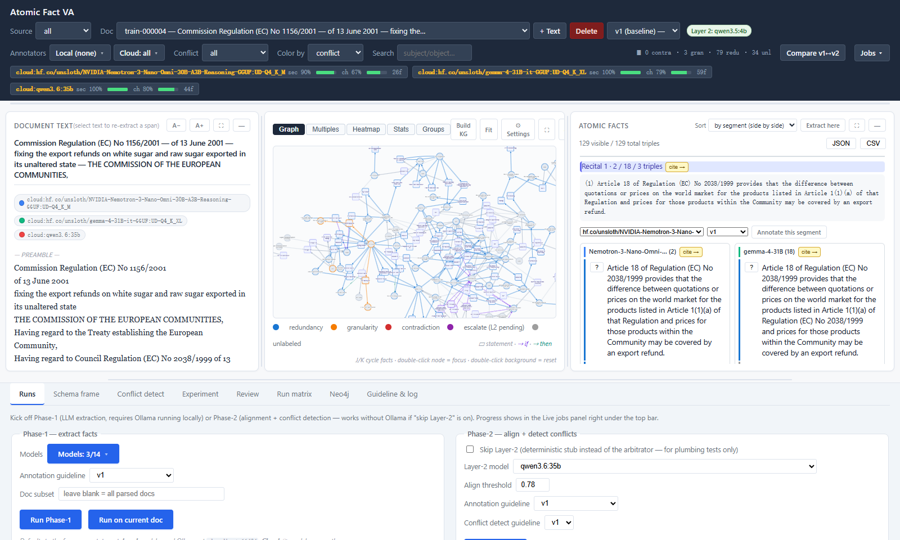
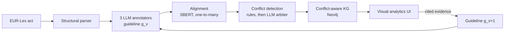

# Visual Analytics for Atomic Fact Annotation

**Why do LLM annotators disagree, and can that disagreement be used to write a
better annotation guideline?**

Master's thesis · University of Konstanz, in cooperation with FIZ Karlsruhe · 2026 (in progress)




## The problem

Factuality metrics for LLM output split a text into **atomic facts** and check
each one. The number of facts is the denominator of the score, and where one
fact ends and the next begins is set by an **annotation guideline**. If two
annotators cut the same sentence differently, the score moves even though
nobody got a fact wrong.

This project makes those disagreements **diagnosable**. Several LLMs annotate
the same legal documents; the system aligns their facts, labels each
disagreement, and shows it as a knowledge graph next to the source text. The
diagnosis drives a documented revision of the guideline, which is then tested
on held-out documents on two questions:

- **Agreement:** do the annotators converge after the revision?
- **Correctness:** do their facts get closer to a human-adjudicated reference?
  And do they beat a *no-feedback control* revision, written without looking at
  any conflicts, which separates the effect of the evidence from the effect of
  simply rewriting the guideline?

## How it works



1. **Parse.** A structural parser for EU legislation splits each act into
   citations, recitals, articles and annexes with character offsets. It also
   rebuilds tables that the Official Journal's plain-text export flattened.
2. **Extract.** Three open-weight 30B-class LLMs, served through Ollama, turn
   every recital and article into Subject–Predicate–Object facts. Time,
   condition and negation are attached as qualifiers. Every fact is anchored to
   a verbatim quote from the source (exact match first, then fuzzy matching).
3. **Align.** Facts from different annotators are embedded with Sentence-BERT
   and matched **one-to-many**, so "one coarse fact against three fine ones"
   counts as a granularity difference rather than as two misses.
4. **Classify.** Deterministic rules label redundancy, numeric divergence and
   polarity mismatch. What they cannot decide goes to an LLM arbiter at
   temperature 0. The labels are *agreement*, *redundancy*, *granularity* and
   *contradiction*, and unmatched facts are counted as coverage gaps.
5. **Explore.** Statements are reified as nodes in Neo4j, so conditions and
   "if–then" links are part of the graph instead of being flattened away. The
   Cytoscape.js front end offers graph, small-multiples, similarity heatmap and
   group views, all linked to the source text and the fact table.
6. **Revise.** The guideline editor records every rule change together with the
   annotations it was based on, freezes a version with a SHA-256 lock, and
   compares two versions on the same documents.

## Engineering highlights

- **Experimental discipline enforced in code.** The interface refuses to run on
  the locked evaluation documents (HTTP 403). Interactive runs cannot overwrite
  a batch run of record (HTTP 409). Conflict detection defaults to the frozen
  thresholds, annotators and arbiter, so a forgotten flag costs a slow run
  instead of quietly producing numbers from a different setup.
- **Evaluation without an LLM judge.** Output is scored against the reference
  by slot-wise embedding matching, with numeric vetoes: in legal text, the
  number of a cited regulation *is* its identity.
- **Defensive parsing of messy legal text.** Regions the parser cannot place are
  kept and logged rather than dropped. A table whose layout cannot be recovered
  is flagged, and no rows are invented.
- **Pluggable model backends.** Each model id is routed to a local Ollama or to a
  hosted endpoint, and a local model that will not fit in available VRAM is
  refused. Responses are streamed so long generations survive an
  idle-timeout gateway.
- **Tested and containerised.** 369 hermetic tests; app and Neo4j run with
  Docker Compose.

## Tech stack

| Layer | Tools |
|---|---|
| LLM inference | Ollama (local GPU or hosted), Qwen 3.6, Gemma 4, Nemotron 3 |
| NLP | Sentence-Transformers (`all-MiniLM-L6-v2`), RapidFuzz, scikit-learn, SciPy |
| Data and validation | Pydantic, HuggingFace `datasets`, BeautifulSoup, lxml |
| Knowledge graph | Neo4j with APOC, Cypher conflict-pattern templates |
| Backend | Python 3.11, Flask, Typer |
| Front end | Cytoscape.js (fCoSE and Dagre layouts), plain JavaScript |
| Infrastructure | Docker Compose, pytest |

## Quick start

You need [Docker Desktop](https://www.docker.com/products/docker-desktop/).

```bash
docker compose up --build
```

Then open **http://localhost:5000** for the interface and
**http://localhost:7474** for the Neo4j browser (user `neo4j`, password
`test12345`, which you can change in `.env`; see `.env.example`).

Download the corpus (EU legislation from EUR-Lex, via HuggingFace `lex_glue`):

```bash
docker compose exec app python -m scripts.select_short_docs --n 50
```

Extraction runs on [Ollama](https://ollama.com). Ollama stays on the host, where
it has the GPU, and the container reaches it at `host.docker.internal:11434`. To
let it accept those connections, set `OLLAMA_HOST=0.0.0.0` and restart Ollama.
Runs start from the **Runs** tab of the interface, or on the command line with
`scripts/run_extraction.py` (facts) and `scripts/run_phase2.py` (alignment and
conflicts).

Without Docker, use Python 3.11: `pip install -r requirements.txt`, then
`python -m ui.app`.

## Repository layout

| Path | Contents |
|---|---|
| `src/` | The pipeline: parsing, extraction, alignment, conflict detection, KG construction, gold scoring |
| `ui/` | Flask backend and single-page front end |
| `scripts/` | Batch drivers (extraction, conflict detection, Neo4j export) and data tools |
| `cypher/` | Neo4j schema and conflict-pattern queries |
| `tests/` | Hermetic unit tests: `pytest -q tests` |

## Status

The thesis is in progress and due in autumn 2026. The system is complete; the
experiments are running. This repository holds the **code**. The annotation
guidelines, the reference annotation (machine pre-annotated, human-adjudicated)
and the experiment data belong to the thesis and will be published with it.

**Author:** Zilong Yan, M.Sc. student, University of Konstanz
